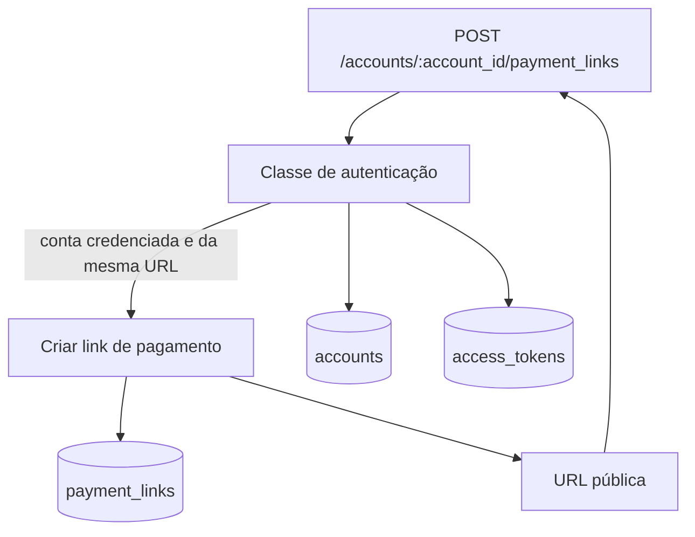

# C4 — Componentes

Componentes da fatia “criar link de pagamento”, dentro da API Rails. A página do pagador não existe.

| Componente | Responsabilidade |
| --- | --- |
| Endpoint de criação | Lê o Bearer, o `account_id` da URL e o JSON. Traduz 401, 403 e 422. |
| Classe de autenticação | Valida o Bearer, amarra a requisição à conta do token e verifica o credenciamento. |
| Criar link de pagamento | Exige valor maior que zero, descrição presente e moeda BRL. Grava o link ativo. |
| URL pública | Monta `https://pay.example.com/c/{token}` sem colocar `account_id` no path. |

Ordem obrigatória: a criação só roda depois da autenticação. Valor inválido não grava linha. Conta de outro token não grava linha na conta informada na URL.
