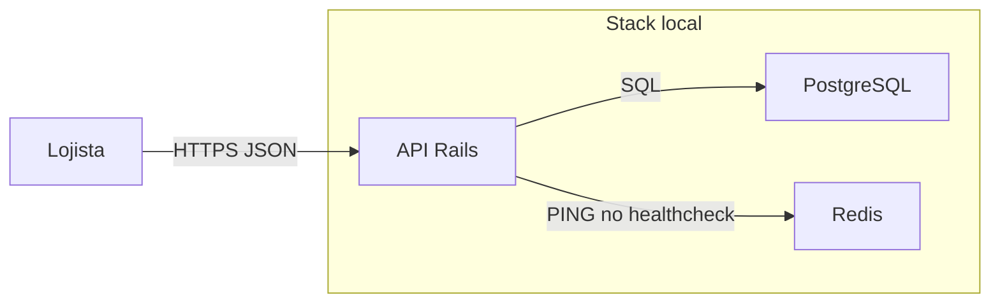

# C4 — Contêineres

Ambiente local descrito em `compose.yaml`: a API Rails, o PostgreSQL e o Redis.

| Contêiner | Responsabilidade |
| --- | --- |
| API Rails | HTTP, regra de criação do link e montagem da URL. Processo `web` no Compose, porta 3000. |
| PostgreSQL | Contas, tokens e links. Serviço `db`. No host a porta publicada é 5433. |
| Redis | Consultado por `GET /status`. A criação do link não depende dele. |

`GET /up` é o healthcheck do Rails. `GET /status` responde `ok` só quando Postgres e Redis respondem.
