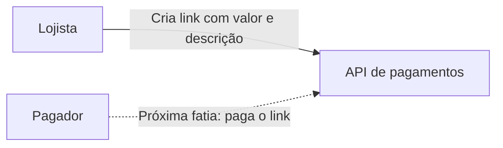

# C4 — Contexto

O lojista cria um link pela API. O pagador e o provedor de cartão ou Pix ficam de fora desta fatia.

| Elemento | Papel nesta fatia |
| --- | --- |
| Lojista | Envia o Bearer da própria conta e os dados da cobrança. |
| API de pagamentos | Este sistema. Autentica, persiste o link e devolve a URL. |
| Pagador | Não chama a API agora. A URL já nasce para ele usar depois. |
