# Modelo de dados

Desenho alvo desta fatia. As tabelas ainda não existem no banco.

```mermaid
erDiagram
  accounts ||--o{ access_tokens : possui
  accounts ||--o{ payment_links : possui

  accounts {
    string id PK
    boolean credentialed
  }

  access_tokens {
    bigint id PK
    string account_id FK
    string token_digest UK
  }

  payment_links {
    bigint id PK
    string public_id UK
    string url_token UK
    string account_id FK
    string status
    string description
    integer amount_cents
    string currency
    datetime created_at
    datetime updated_at
  }
```

| Tabela | Regras |
| --- | --- |
| `accounts` | `id` é o identificador público (`loja-abc`). `credentialed` diz se a conta pode receber. Sem fluxo de cadastro nesta fatia. |
| `access_tokens` | Guarda só o digest SHA-256 do Bearer. O token cru aparece no teste e no header, não na tabela. |
| `payment_links` | Nasce com `status = active`. `public_id` é `pl_` mais o token. `url_token` é o segmento opaco da URL. `amount_cents` é inteiro maior que zero. `currency` nesta fatia é `BRL`. |

Um link pertence a exatamente uma conta. A conta do registro é a conta do token, nunca a conta citada na URL quando as duas diferem.
